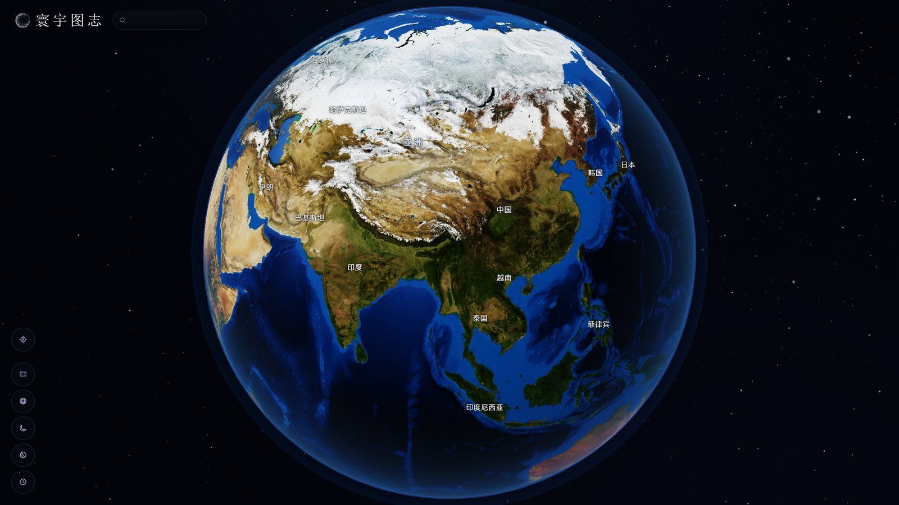
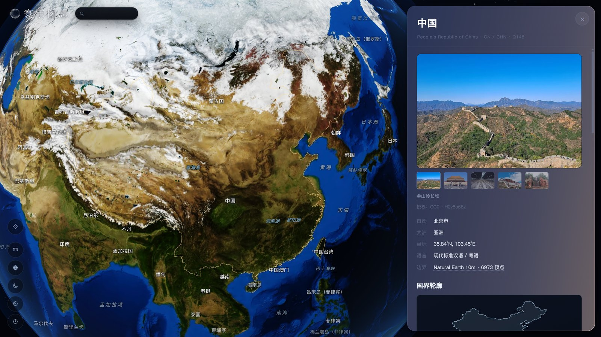
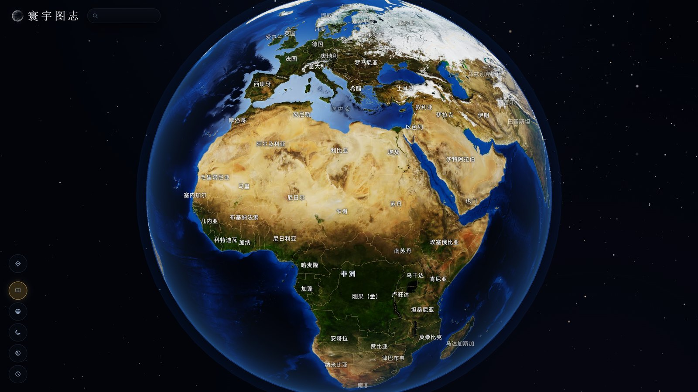

<div align="center">

# 寰宇图志 · Atlas Mundi

**一颗可以点开的 3D 地球：240 个国家与地区的地标影像、语言、地理与人文。**

[在线体验](https://zzq1419.github.io/atlas-mundi/) · [数据格式](#数据格式) · [本地运行](#本地运行) · [数据来源](#数据来源与许可)



</div>

## 这是什么

一颗可以拖动、可以放大的 3D 地球，上面有国界、地名和地标。点任意一个国家，镜头飞过去、
把边界勾成金色，右侧展开一份档案。

档案里按顺序是这些东西：

- **地标照片**——首图 + 缩略图条，可以来回切；照片下面是中文图注和「授权 / 作者」，
  竖构图的照片会自动改成完整装下而不是裁切
- **五行事实**——首都、大洲、中心坐标、语言、国界数据的来源与顶点数
- **国界轮廓图**——等距圆柱投影画的 SVG，从分片几何里现取，不依赖任何地图库
- **三段正文**——概况、历史、民俗，关键词会在文中标注出来
- **文化特征**——关键词、节庆、饮食、宗教、建筑、遗产六组标签；
  鼠标停在任意一个标签上，能看到它抽取时的**原文依据**
- **语音**——每种语言一条播放器，配原文和中文翻译；没有对应音色的语种会如实写「暂无语音」，
  不用邻近语种硬读冒充

搜索框则做另一件事：**可以直接拿自然语言提问**，「法国人吃什么」「埃及有什么宗教」
都行，答案来自构建期为每个国家写的 6~8 组问答对。检索在浏览器里用 2-gram + BM25 算，
点结果会跳到那个国家、并把档案滚到相关段落——所以问答不在档案卡里，是搜索出来的。

所有内容都在构建期采集、清洗、整理好，运行时是一个**纯静态页面**：没有后端、没有数据库、
也没有运行时的大模型调用。丢进任何静态托管就能跑。

| 项目 | 规模 |
| --- | --- |
| 国家 / 地区档案 | **235** 份（229 份完整，6 份仅基础字段） |
| 可点地名 | **339** 个（240 国家 · 31 海域 · 7 大洲 · 61 岛屿与海峡） |
| 地标影像 | **1089** 张，逐张保留授权与作者 |
| 语言与发音 | **383** 条语言记录，**289** 段语音 |
| 检索语料 | **1968** 条（1733 组问答 + 235 条国家简介） |
| 前端 | 单文件 `index.html`，无构建步骤 |

<table>
<tr>
<td width="50%"></td>
<td width="50%"></td>
</tr>
<tr>
<td><sub>点击国家：镜头上移并勾出国界，档案卡从右侧展开</sub></td>
<td><sub>叠加全部国境线：0.06° 抽稀的边界一次性合成一条线</sub></td>
</tr>
</table>

## 功能

- **可拖拽的 3D 地球**——带惯性的旋转与缩放、大气散射、星空、昼夜两种底图
- **点哪儿看哪儿**——点国界或点国名都飞向该国，同时勾出它的边界
- **国家档案卡**——地标照片、结构化事实、国界轮廓、历史民俗、文化标签、分语言语音
- **直接提问**——「法国人吃什么」也能命中，检索在浏览器里算，断网可用
- **时间指示**——在地图上钉一枚旗子，看当地此刻的日期时间
- **国境线开关**——单国高亮，或一次性叠上全世界

## 技术栈与刻意的取舍

| 选型 | 说明 |
| --- | --- |
| three.js | 唯一的外部运行时依赖，从 CDN 与本地各取一份 |
| 原生 HTML / CSS / JS | **单文件**，无 React / Vue / Vite / TypeScript、无打包步骤 |
| 纯静态 | 无后端、无数据库。数据是构建期生成的 JSON，前端直接 `fetch` |
| 构建期脚本 | Python（采集、清洗、校验、出图），不进运行时 |

选单文件不是偷懒，是为了让"改一个数字就能看到效果"这件事成立：克隆下来起个静态服务器
就能改，不用装 Node、不用等构建。

## 几个值得说的实现

### 1. 贴图按放大倍率分工，而不是一次load最大的

清晰度只取决于贴图本身。全球视角下 4096 已经够用（约 1.3 texel/px），但贴近看时就只剩
0.5 texel/px，明显发糊；而 8K 纹理在显存里是 8192×4096×4 ≈ 134MB，一上来就加载等于让弱设备
白等几秒。

所以做成两级、8K 懒加载——4K 先到、球淡入；8K 等用户真的推近才下载、才绑定。两张图在
shader 里按**每像素吃几个纹素**软过渡，没有切换痕迹：

```glsl
float tpp = max(fwidth(vUv.x), fwidth(vUv.y)) * 8192.0;  // 每像素吃几个 8K 纹素
float k   = smoothstep(1.5, 0.8, tpp) * uMixB;           // 放大才用 8K
vec3  day = mix(tex4K, tex8K, k) * limb;
```

因为缩小的情况全部交给带 mipmap 的 4K，8K 这一张可以**完全不建 mipmap**，省掉最贵的一步。

### 2. 国界线：先抽稀到一像素，再合成一次 draw call

Natural Earth 10m 的原始边界有几百万个点。按 0.006° 抽稀后，球面上仍然有 99% 的点落在
同一个像素里——纯属白传。真正给"全部国境线"这一层用的数据按 0.06° 重抽，体积从 4.0MB
降到 **721KB**（gzip 236KB）；339 个国家与地区的环合成一条 `LineSegments`，一次 draw call。

那份数据同时按国家分组，所以「点亮某一个国家」不需要任何网络请求——直接从内存里切出它的
几圈环，点击当帧就能亮。

### 3. 点击拾取必须 `worldToLocal`

射线与球求交拿到的是**世界坐标**。球体被倾斜层与自转层两个 Group 旋转过，直接拿世界坐标
反算经纬度会整体错位。必须先转回局部坐标：

```js
spin.worldToLocal(hit.point)   // 再反算 lon/lat
```

### 4. 地名要像地图，而不是三个开关

地名的出现顺序、位置、避让都来自 Natural Earth 的制图字段：`MIN_LABEL` 决定它从第几级缩放
开始出现，`LABELRANK` 决定抢位优先级，`LABEL_X/Y` 是制图师放的锚点（不是几何中心——挪威的
几何中心在海上）。

渲染时把相机距离换算成 Natural Earth 的 zoom 级别，再按门槛放行；放不下就按重要度让位。
339 个名字同时铺上去必然糊成一团，**避让**才是"像地图"的来源。

### 5. 让镜头飞行不卡：一次关于高分屏的排查

点击国家后镜头会飞 0.7~1.6 秒，这段时间最容易掉帧。用"只改 `devicePixelRatio`"的办法测，
掉帧次数是这样的：

| 屏幕缩放 | 掉帧 | 4× MSAA |
| --- | --- | --- |
| 1.00 | 13 | 开 |
| 1.25 | **25** | 开 |
| 1.50 | 10 | 关 |
| 2.00 | **80** | 关 |

原因不是像素数量，而是**多重采样抗锯齿**：片元着色器本身已经很重（昼夜双贴图混合、法线
扰动、体积光、海面高光、色调映射），MSAA 再把带宽翻四倍，集成显卡上直接超过一帧预算。
`dpr ≥ 1.25` 时屏幕本身就在超采样，关掉 MSAA 视觉几乎无损，掉帧从 25 / 80 降到 8 / 11。

另外两条同源的经验：卡片里的照片改成**镜头停稳后再取**（下载+解码+传 GPU 全落在飞行段，
冷缓存卡、热缓存不卡，正是"有时卡有时不卡"的来源）；地名每帧最多新上 10 个，飞行期间在场地名
封顶 34 个——否则点开一个国家时会有几十个名字在同一帧里被栅格化。

### 6. 检索在浏览器里算

每国 6~8 组问答对在构建期生成，加上 235 条国家简介，合并成一份 1968 条的语料；前端用中文
2-gram 切分 + BM25 打分，零依赖、断网可用。两个细节决定它能不能用：**停用词**（否则"哪里
能看长城"会被一条"首都是哪里"顶到前面）与**双重阈值**（绝对分 + 最高分的 35%，低于阈值就
明确回答"没有"）。

## 数据格式

`data/index.json` 是入口，只放列表需要的字段；详情按主键再取 `data/{iso}.json`。

| 字段 | 说明 |
| --- | --- |
| `iso_a2` / `iso_a3` / `qid` | 主键与回溯标识 |
| `name_zh` / `name_en` / `name_local` | 三语名称 |
| `capital` / `continent` / `centroid` | 首都、大洲、地理中心 |
| `languages[]` | 语言、角色（官方/区域）、语音状态与音频地址 |
| `landmark_images[]` | 图片地址、中文图注、**授权与作者** |
| `summary_text` / `custom_text` | 地理概览、历史与人文 |
| `custom_facets` | 结构化标签（气候、宗教、饮食…），每条带原文依据 |
| `knowledge_qa[]` | 检索用的问答对 |
| `sources[]` | 每个字段的来源链接 |

同一份档案里还内联了一份**粗轮廓**（0.05° 抽稀、整数化，平均 1.5KB），所以卡片和国界线
永远是同一个响应到达，不会出现"卡片展开了、线还在路上"。精细几何随后覆盖，放大后细节不丢。

## 目录结构

```
atlas-mundi/
├── index.html          # 整个前端（3D 地球、档案卡、检索）
├── data/               # 235 份国家档案 + index.json + search.json
├── geo/                # 国界几何（分片 + 单国 + 全量边界 + 地名）
├── assets/             # 地标图（WebP 双尺寸）与语音
├── vendor/             # three.js
├── scripts/            # 构建期 Python：采集、清洗、校验、出图（win/ 里是双击启动器）
└── docs/               # 采集流程说明与本文配图
```

## 本地运行

静态页面，起一个本地服务器即可（`file://` 下浏览器禁止 `fetch`，数据会加载失败）：

```bash
python -m http.server 8000
# 打开 http://localhost:8000/
```

## 重新生成数据（可选）

仓库里已经带了完整数据，只想跑前端的话跳过这一节。要自己跑一遍采集链路：

```bash
python scripts/collect_all.py --plan            # 先看看还差多少
python scripts/collect_all.py --stage collect   # 正文、语言、坐标
python scripts/collect_all.py --stage landmarks # 地标图
python scripts/collect_all.py --stage llm       # 摘要 / 图注 / 特征 / 质检（需 key）
python scripts/collect_all.py --stage speech    # 语音合成
```

逐阶段的细节、耗时与踩过的坑见 [`docs/全量采集.md`](docs/全量采集.md)。Windows 上不想敲命令的话，
[`scripts/win/`](scripts/win) 里有几个双击就能跑的启动器（第一步解析试采 → 第二步全量采集）。

几个约定：

- **密钥只走环境变量**（如 `DEEPSEEK_API_KEY`），`.env` 已在 `.gitignore` 里。页面永不接触
  key——静态站是公开的，前端一旦出现 key 就等于泄露，所以所有模型调用都在构建期完成，
  页面只读结果。
- **图片逐张校验授权**：取不到 Commons 授权字段的图直接丢弃，不进数据集。
- **入库前过门禁**：`python scripts/check_data.py` 检查字段齐全、素材存在、几何合法、
  `index.json` 与档案一致。CI 里跑的是同一条命令。

## 数据来源与许可

| 内容 | 来源 | 许可 |
| --- | --- | --- |
| 国界与地名 | [Natural Earth](https://www.naturalearthdata.com/) 1:10m / 1:50m | 公有领域 |
| 地球底图 | NASA Blue Marble / Black Marble | 公有领域 |
| 地标影像 | Wikimedia Commons | 逐张保留，见档案里的 `license` / `author` |
| 文字内容 | 维基百科摘要经模型整理，人工校订 | CC BY-SA 4.0 |

代码以 MIT 许可发布（见 [LICENSE](LICENSE)）；**图片、文字与地理数据仍归各自来源的许可**，
转载或二次分发时请按档案里记录的授权信息署名。

## 已知限制

- 6 个国家只有基础字段（位置、语言、人口），没有完整地标影像，卡片上会明确标注。
- 8K 底图按设备能力降级：`MAX_TEXTURE_SIZE` 只有 4096 的移动端会一直用 4K。
- 素材有两份来源（对象存储 + 仓库内相对路径），前者更快、后者更耐断网，代码里自动回退。
- 部分区域语言没有对应音色，档案里直接标注"暂无语音"，不用邻近语种硬读冒充。

## 致谢

数据来自 [Wikidata](https://www.wikidata.org/)、[Wikipedia](https://www.wikipedia.org/)、
[Wikimedia Commons](https://commons.wikimedia.org/) 与 [Natural Earth](https://www.naturalearthdata.com/)，
渲染基于 [three.js](https://threejs.org/)。
